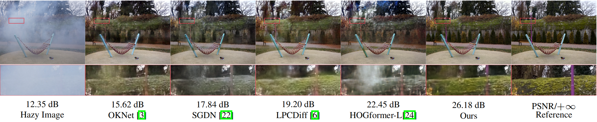
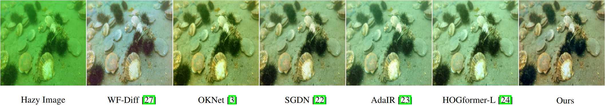

# DARDiff: Anchor-Conditioned Residual Diffusion for Real-World Image Dehazing

---

## 🧠 Network Architecture

---
## 📊 Visualize the results
!

---

###  ⚠️ Notice
Our code will be open source soon.

## 🙏 Acknowledgment 

Our project is based on **[OKNet](https://github.com/c-yn/OKNet)** and **[LPCDiff](https://github.com/yz-wang/LPCDiff)**, and we are very grateful for this excellent work.

